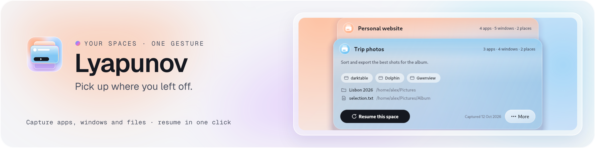
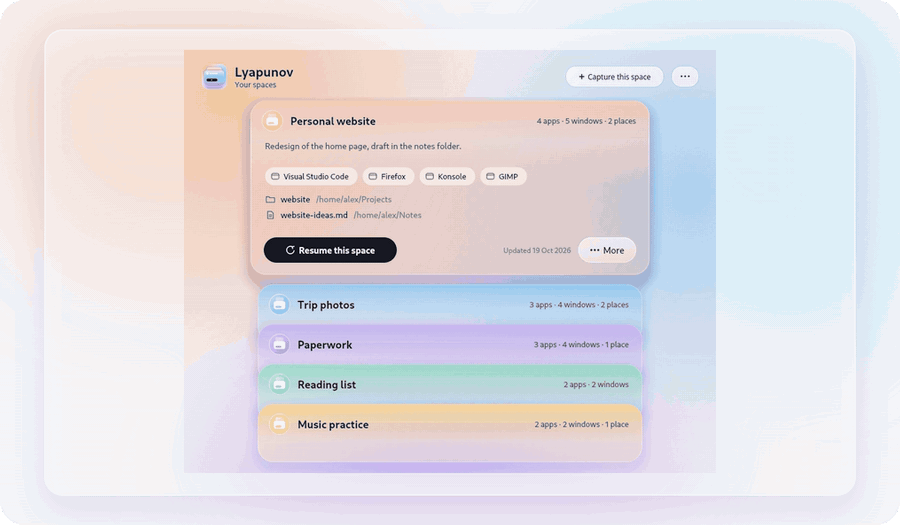
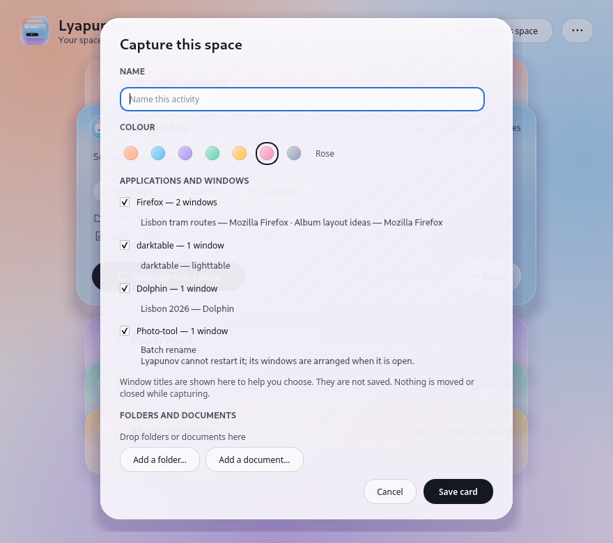
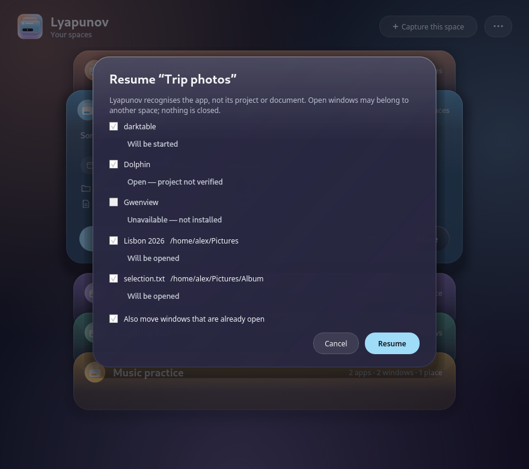
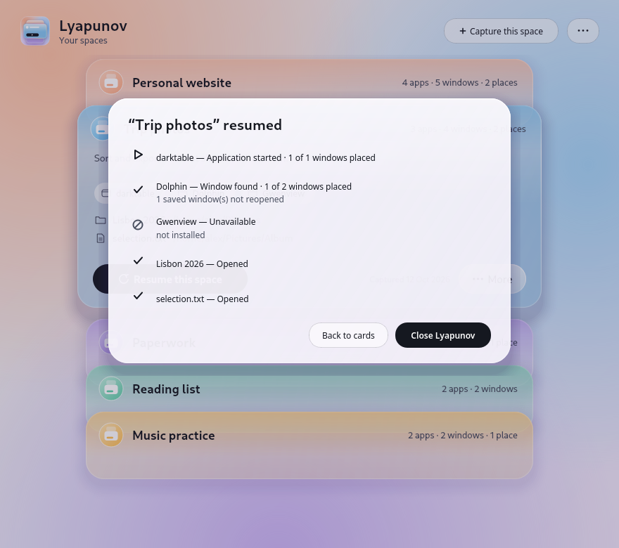
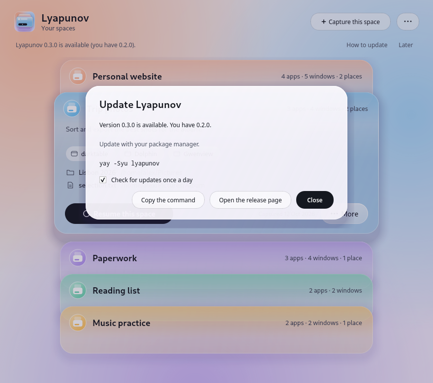

<p align="center">
  <picture>
    <source media="(prefers-color-scheme: dark)" srcset="docs/media/banner-dark.png">
    
  </picture>
</p>

<p align="center">
  <a href="https://github.com/Chaos-Tic/Lyapunov/actions/workflows/ci.yml"></a>
</p>

# Lyapunov

**Save what you are working on as a card. Come back to it later, in one gesture.**

> *Why Lyapunov?* The project is named after **Aleksandr Lyapunov** (1857–1918),
> whose theory of stability describes how a system returns to its point of
> equilibrium after being pushed away from it. Fitting for a tool by
> [Chaos-Tic](https://github.com/Chaos-Tic): you are pulled from one task to
> another, and your work space finds its way back.

<p align="center">
  <picture>
    <source media="(prefers-color-scheme: dark)" srcset="docs/media/hero-dark.gif">
    
  </picture>
</p>

A **card** is one activity: "Personal website", "Trip photos", "Paperwork". It
keeps application identities and window layouts, plus the folders and
documents you chose to add. **Resuming** starts missing applications, leaves
open ones running, and arranges newly opened windows as far as your desktop
allows. Moving windows that were already open is an explicit option. The
optional VS Code integration can distinguish one local project folder per
window; other applications are recognised by app identity only. Before anything happens,
Lyapunov shows what it will do; afterwards it says exactly what it did:
*window found*, *application started* or *unavailable*.

Everything runs on your computer. No account, no telemetry; the only network use is a
once-a-day check for a new version on GitHub, which you can turn off.
Cards are small JSON files in a private folder.

**Version 0.2.0.** Install it with your package manager, [from source](#install), or
from the [latest release](https://github.com/Chaos-Tic/Lyapunov/releases/latest);
Lyapunov tells you when a newer version is out.
Package-manager channels are listed in [Packaging](packaging/README.md) as
they become available. What is verified and what is not is listed in
[Compatibility](#compatibility).

[Install](#install) · [How it works](#how-it-works) · [Compatibility](#compatibility) · [User guide](docs/USER_GUIDE.md) · [Troubleshooting](docs/TROUBLESHOOTING.md) · [Security](SECURITY.md)

## How it works

<table>
<tr>
<td width="50%"><picture><source media="(prefers-color-scheme: dark)" srcset="docs/media/capture-dark.png"></picture></td>
<td width="50%"><picture><source media="(prefers-color-scheme: dark)" srcset="docs/media/plan-dark.png"></picture></td>
</tr>
<tr>
<td><b>1. Capture.</b> Name the activity and pick a colour. Lyapunov lists the
open applications with their windows; untick what does not belong, add folders
and documents. Nothing is moved or closed. Window titles help you choose and
are never saved.</td>
<td><b>2. Resume.</b> Pick the card, press <b>Resume this space</b> (or Enter).
The preview shows what will start, what is already open and what is missing;
leave out any step. An open application stays open, but its project is not
identified or switched.</td>
</tr>
<tr>
<td><picture><source media="(prefers-color-scheme: dark)" srcset="docs/media/report-dark.png"></picture></td>
<td><picture><source media="(prefers-color-scheme: dark)" srcset="docs/media/update-dark.png"></picture></td>
</tr>
<tr>
<td><b>3. Know what happened.</b> Each application and place gets an exact
result. When Lyapunov arranges a window from a screen that is no longer
connected, it reports the missing screen and places that window on one that is.</td>
<td><b>Always current.</b> Once a day Lyapunov checks for a new release and
shows how to update with your package manager, winget or a download. It
follows the system's light or dark scheme and language (English, French);
keyboard: arrows, Enter, Delete, F2, the menu key.</td>
</tr>
</table>

## Install

Lyapunov builds on any Linux distribution with Qt 6.4 or newer and Rust 1.85
or newer. The installer finds your package manager (pacman, apt, dnf, zypper,
xbps, apk, emerge), installs the build tools after asking, and installs
Lyapunov for your user in `~/.local`:

```sh
git clone https://github.com/Chaos-Tic/Lyapunov.git
cd Lyapunov
./install.sh
```

On GNOME, the installer also offers the small Shell extension that lets
Lyapunov see and arrange windows (log out and back in once afterwards). On KDE
Plasma, **Meta+Alt+Space** opens Lyapunov. Remove it with `./uninstall.sh`;
your cards are kept unless you say otherwise.

For a direct source install using the standard CMake install rule:

```sh
cargo build --release --locked
cmake -S . -B build -DCMAKE_BUILD_TYPE=Release -DBUILD_TESTING=OFF \
  -DLYAPUNOV_INSTALL_GNOME_EXTENSION=OFF
cmake --build build
cmake --install build --prefix "$HOME/.local"
```

Cargo builds the Rust command; CMake builds the Qt interface and installs both,
with the menu entry, icons and license, through one standard install rule. For
distribution packages, `DESTDIR="$pkgdir" cmake --install build --prefix /usr`
places those files in a temporary package directory without changing the live
system. `install.sh` uses the same rule and also offers missing build tools and
the GNOME extension.

Release packages are built and checked by the tagged CI run:

| System | Package | Built and installed in CI |
| --- | --- | --- |
| Debian 12+, Ubuntu 24.04+ | `.deb` | Debian 12, Debian stable, Ubuntu 24.04, Ubuntu latest |
| Fedora | `.rpm`, COPR spec | Fedora latest |
| Arch Linux | `PKGBUILD` (AUR) | Arch |
| Any recent Linux | AppImage | built on Ubuntu 22.04 |
| Windows 10 and 11 | `Lyapunov-Setup-x64.exe` | silent install, capture, resume, uninstall |

For packages that receive updates through the system package manager:

| System | Install |
| --- | --- |
| Debian 12+ and Ubuntu 24.04+ | Follow the [Chaos-Tic apt repository instructions](https://github.com/Chaos-Tic/apt#install), then `sudo apt install lyapunov` |
| Fedora 43–45 | `sudo dnf copr enable chaostic/lyapunov && sudo dnf install lyapunov` |
| Arch Linux | Build and install [`lyapunov` from the AUR](https://aur.archlinux.org/packages/lyapunov) |

The Windows installer and standalone Linux files are on the
[latest release page](https://github.com/Chaos-Tic/Lyapunov/releases/latest).

## Compatibility

Every check below captures a real window, moves it through a card, closes the
application and lets Lyapunov start it again, then simulates an unplugged
screen and a second desktop. They run in **isolated sessions** (private
compositor or X server, private D-Bus, virtual screen) with
[`tests/e2e/session_check.py`](tests/e2e/session_check.py). Dated
2026-10-20.

| Desktop | Windows listed | Moved and resized | Virtual desktops | Maximised / minimised | Checked in |
| --- | --- | --- | --- | --- | --- |
| KDE Plasma 6 (KWin, Wayland and X11) | yes | yes | yes | yes | nested KWin 6.8 ([`test-kwin-isolated.sh`](scripts/test-kwin-isolated.sh)); reading windows on a real Plasma 6.8 session |
| GNOME 50 (with the Shell extension; 45–49 declared) | yes | yes | yes | yes | headless GNOME Shell 50 ([`test-gnome-container.sh`](scripts/test-gnome-container.sh)) |
| Xfce, Cinnamon, MATE, Openbox, LXDE… (X11, EWMH) | yes | yes | yes | yes | Openbox and Xfwm4 ([`test-sessions-container.sh`](scripts/test-sessions-container.sh)) |
| sway, i3 | yes | floating windows; tiled ones keep their workspace | workspaces | full screen | sway (headless) and i3 |
| Hyprland | yes | floating windows; tiled ones keep their workspace | workspaces | — | parsing tests only |
| Windows 10 and 11 | yes | yes | current desktop only | yes | listing on a CI runner (Windows Server) |
| GNOME without the extension, COSMIC, other Wayland compositors | — | — | — | — | applications, folders and documents still reopen |

Not verified yet: real sessions of Plasma (moving windows), GNOME, Cinnamon,
Hyprland and Windows 10/11 desktops. Details and the checklist used before a
release: [docs/COMPATIBILITY.md](docs/COMPATIBILITY.md).

## What a card does not restore

Text you have not saved, tabs, history or selection inside an application,
a website login, a password or a disconnected device.
A card is a saved recipe, not a paused virtual desktop: it does not close,
freeze or autosave applications. On Linux, install the optional
[VS Code extension](integrations/vscode/README.md) and choose a project folder
for the VS Code entry in a card. Resuming B then opens B in a separate window
while A remains open; another resume recognises B and leaves it in place.
The integration does not restore VS Code's unsaved state or place its windows.
Other applications have no project-level integration yet. Browser tabs may
come later through an optional extension.

## Privacy

- Local only: no account, no server, no telemetry, no listening port. The window
  asks GitHub once a day whether a newer release exists (one anonymous request,
  nothing about you or your cards; **⋯ → Check for updates once a day** turns it
  off) and then shows how to update with your package manager, winget or a download.
- Cards keep application identities, window positions and the folders and
  documents you add. Window titles and URLs are never stored.
- Deleting a card never touches the files or applications it lists.
- A card only opens folders and documents: programs, scripts, launchers and
  network locations are refused, and imported cards always show their plan
  before the first resume. See [SECURITY.md](SECURITY.md).

## Command line

The desktop is built on the `lyapunov` command, which works on its own:

```sh
lyapunov capture "Paperwork" --place ~/Documents/Taxes
lyapunov list
lyapunov plan "Paperwork"        # what resuming would do
lyapunov resume "Paperwork"      # do it, and report
lyapunov doctor                  # what this desktop allows
```

Every command accepts `--json`. See `lyapunov --help` and
[docs/ARCHITECTURE.md](docs/ARCHITECTURE.md).
The command line leaves already open windows in place unless you pass
`--arrange` explicitly.

## Building

```sh
cargo build --release
cmake -S . -B build -DCMAKE_BUILD_TYPE=Release && cmake --build build
cargo test && ctest --test-dir build
```

Session checks: `scripts/test-kwin-isolated.sh` (needs KWin),
`scripts/test-sessions-container.sh`, `scripts/test-gnome-container.sh` and
`scripts/test-packages-container.sh` (need Docker or Podman). The screenshots
and the animation above are generated from demo data by
`scripts/render-docs.sh`. More in [docs/TESTING.md](docs/TESTING.md).

## License

Copyright (c) 2026 Chaos-Tic. Lyapunov is free software under the GNU General
Public License v3.0 or later ([LICENSE](LICENSE)): anyone who redistributes it,
modified or not, must keep this notice and publish the source under the same
license. The name and the logo identify the official project and may not be
used for a fork ([TRADEMARKS.md](TRADEMARKS.md)). Issues are welcome; see
[CONTRIBUTING.md](CONTRIBUTING.md).
