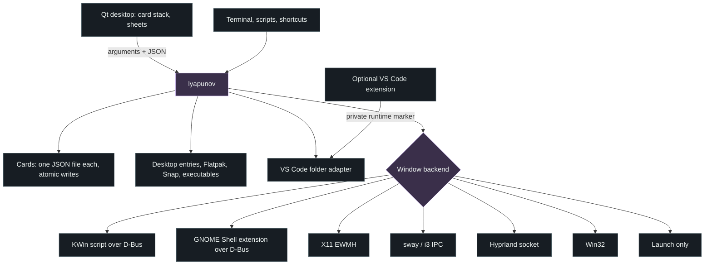

# Architecture

[Back to the README](../README.md)

Lyapunov separates its interface from the work. The Rust executable
`lyapunov` owns cards, window backends, capture and resume; the Qt desktop
`lyapunov-desktop` talks to it through subprocesses, with arguments in and
JSON out. No HTTP server or network socket is involved anywhere.



## Source map

| Path | Responsibility |
| --- | --- |
| [`src/card.rs`](../src/card.rs) | The card format, its validation, duplicates, differences between two captures |
| [`src/store.rs`](../src/store.rs) | The private cards folder: listing, atomic saves, order, problems |
| [`src/apps.rs`](../src/apps.rs) | Recognising an application from its window, starting it, opening folders and documents safely |
| [`src/capture.rs`](../src/capture.rs) | Grouping open windows by application into a card |
| [`src/resume.rs`](../src/resume.rs) | The plan, starting and waiting, fitting windows onto present screens, the report |
| [`src/vscode.rs`](../src/vscode.rs), [`integrations/vscode/`](../integrations/vscode/) | Opt-in Linux VS Code project recognition through a private runtime marker |
| [`src/backend/`](../src/backend/) | One file per desktop technology, and the detection that picks one |
| [`src/integrate.rs`](../src/integrate.rs) | Menu entry, icons, GNOME extension installation and trust |
| [`src/main.rs`](../src/main.rs) | The command line |
| [`desktop/`](../desktop/) | The Qt interface: Liquid Glass painting, the card stack, sheets, translations, the daily update check (`update.h`, the only network use) |
| [`integrations/gnome-shell/`](../integrations/gnome-shell/) | The GNOME Shell extension |
| [`tests/`](../tests/) | Card stack test, isolated session checks, demo data for screenshots |
| [`packaging/`](../packaging/) | Packages for every platform (see its README) |

## A card

```json
{
  "format": "lyapunov-card", "version": 2,
  "id": "…uuid…", "name": "Trip photos", "note": "", "tint": "sky",
  "created": "2026-10-20T15:04:05Z", "modified": "2026-10-20T15:04:05Z",
  "apps": [{
    "name": "Dolphin", "desktop": "org.kde.dolphin.desktop", "class": "dolphin",
    "windows": [{ "rect": { "x": 40, "y": 40, "width": 900, "height": 700 }, "state": "normal",
                  "output": "DP-1", "output_rect": { "x": 0, "y": 0, "width": 2560, "height": 1440 },
                  "desktop": { "id": "…", "name": "Photos", "index": 1 } }]
  }],
  "places": [{ "path": "/home/alex/Pictures/Lisbon 2026", "kind": "folder" }],
  "resume": { "ask": true, "arrange_open_windows": true }
}
```

- Applications are known by their **desktop entry** (Linux), their
  **executable** (Windows), or only by their **window class** when nothing
  can start them again; those are arranged when open, never started.
- Rectangles are frame geometry in screen coordinates. The screen's own
  geometry is kept so a window can be moved proportionally when that screen is
  gone or changed size.
- Window titles and URLs are never part of a card.
- A VS Code entry may contain `"workspace": "/absolute/local/folder"`.
  Version 1 cards are read and upgraded when saved. The VS Code adapter
  requires its optional extension; it never arranges a project window without
  a reliable window-to-project mapping.
- Every field is validated on save and on load: lengths, control characters,
  absolute paths, no network paths, desktop entry IDs without separators,
  bounded geometry. A card written by a newer format version is reported and
  left untouched.

## Storage

`$XDG_DATA_HOME/lyapunov` (usually `~/.local/share/lyapunov`), or
`%LOCALAPPDATA%\Lyapunov` on Windows; `LYAPUNOV_DATA_DIR` overrides it. One
file per card in `cards/`, and `order.json`. Folders are 0700 and files 0600.
A save writes a temporary file in the same folder, flushes it, renames it over
the old card and flushes the folder: an interruption leaves the previous card
intact. A file that cannot be read is listed as a problem and never deleted.

## Recognising an application

In order: the compositor's desktop file name (KWin, GNOME), the Flatpak or
Snap sandbox of the process, the window class against desktop entry IDs and
`StartupWMClass`, then the executable against each entry's `Exec` program.
Generic programs (shells, interpreters, `flatpak`, `electron`…) never match on
their own. Entries come from the XDG data folders, Flatpak exports and Snap.

An entry starts from its `Exec` line, split as the Desktop Entry
specification says, without a shell, with file field codes dropped. Processes
are detached (`setsid`); inside an AppImage, the image's library and plugin
paths are removed from the started application's environment.

## Backends

| Backend | How it lists and moves windows |
| --- | --- |
| `kwin` | Writes a short script to a private file, loads it with `org.kde.kwin.Scripting`, runs it once and unloads it. The script answers by calling a D-Bus method on this process's unique name. Data from cards is embedded as JSON, never evaluated as code. |
| `gnome` | Calls the Lyapunov Shell extension (`io.github.ChaosTic.Lyapunov.Shell`), which answers only the Lyapunov executable. |
| `x11` | Reads `_NET_CLIENT_LIST`, frame extents and RandR monitors; moves through `_NET_MOVERESIZE_WINDOW` and `_NET_WM_STATE` like a pager, checks the result, and retries with a configure request when a window manager ignored it. |
| `sway`, `i3` | The shared IPC protocol: workspaces always, geometry for floating windows. Names are quoted for the command parser. |
| `hyprland` | The request socket: workspaces, and geometry for floating windows. Arguments that could break a batch are refused. |
| `windows` | `EnumWindows` filtered like the taskbar, window placements converted to screen coordinates, `SetWindowPlacement` asynchronously. |
| `launch-only` | Everywhere else: applications, folders and documents still reopen. |

`LYAPUNOV_BACKEND` forces a backend; a forced backend that is unavailable is an
error rather than a silent fallback.

## Resume

1. Snapshot the windows, and build the plan: per application *running*,
   *launch* or *unavailable*; per place *open* or *unavailable*.
2. Start the selected applications that have no window open, and open the
   selected places. A failure is recorded and the rest continues.
3. Wait until every started application shows a window (20 seconds at most),
   then a little longer: many applications resize themselves after appearing.
4. Match saved windows to open ones, new windows first, in stacking order.
   Windows already open are moved only if the user explicitly opted in; new
   cards default to leaving them in place because app identity does not prove
   which project or document each window contains.
5. Fit each window onto a present screen (proportionally when its screen is
   gone or resized, always fully visible) and onto the same desktop (by
   identifier, then name, then position).
6. Place them, wait until each reports a real size, and place again those an
   application moved back. Report each application and place.

`LYAPUNOV_DEBUG=1` writes the placements sent and the answers received to
standard error.

## Command interface

- `list`, `show`, `save` (a card on standard input), `edit`, `duplicate`,
  `delete`, `reorder`: the collection.
- `scan [--exclude-pid PID] [--compare CARD]`: what a capture would keep, with
  window titles for the preview only.
- `capture NAME`: scan and save in one step.
- `plan CARD`, `resume CARD [--only KEY] [--skip KEY] [--arrange|--no-arrange]`:
  resume, with one JSON line per progress event and a final report.
- `export`, `import [--dry-run]`: files to keep or move to another computer.
- `doctor`: session, backend, capabilities.
- `integrate`, `gnome-extension`: menu entry, icons, the GNOME extension.

With `--json`, errors are `{"error": "…"}` on standard output with a nonzero
exit status.
